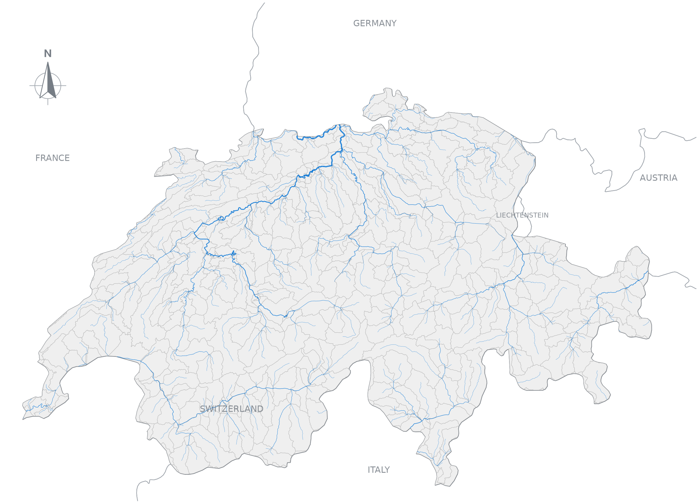

# HFX

**HydroFabric Exchange (HFX)** is a format for sharing hydrofabric data.

In HFX, we understand a **hydrofabric** as a dataset that tiles the landscape into
sub-basins, describes their downstream connections and provides the river network
alongside auxiliary data, when available, such as the flow-direction and
flow-accumulation rasters used to produce it.

The map below shows the [GRIT hydrofabric](https://doi.org/10.1029/2024WR038308)
over Switzerland. Each grey polygon is a sub-basin, with the supplied rivers
shown in blue. The dataset is clipped to Switzerland for display.

*Boundaries: [Natural Earth](https://www.naturalearthdata.com/). Their depiction implies no position on territorial status.*

HFX brings these pieces together in a bundle with a common structure. It preserves
source identities, attributes, connections and provenance, and describes where
each part of the dataset can be found. This lets tools such as
[Pourpoint](https://github.com/pourpoint-tools/pourpoint) read prepared hydrofabrics
through one interface to select rivers and delineate watersheds.

The [documentation](https://pourpoint-tools.github.io/hfx/) explains the data model,
bundle organization, vector storage and optional native-grid rasters. This
repository contains the specification and supporting tools for preparing and
verifying bundles.

## Acknowledgements and licence

GRIT is the work of Michel Wortmann, Louise Slater, Laurence Hawker, Yinxue Liu and
Jeffrey Neal. We thank them for making their hydrography available, and
**Alden Keefe Samson at Upstream Tech for hosting GRIT** for public access.

Repository code is licensed under [MIT](LICENSE). Each dataset retains its own
licence, attribution and reuse conditions. GRIT data and derived outputs carry
**CC BY-NC 4.0** terms. See the [GRIT data publication](https://zenodo.org/records/17435232)
for citation and source details.
